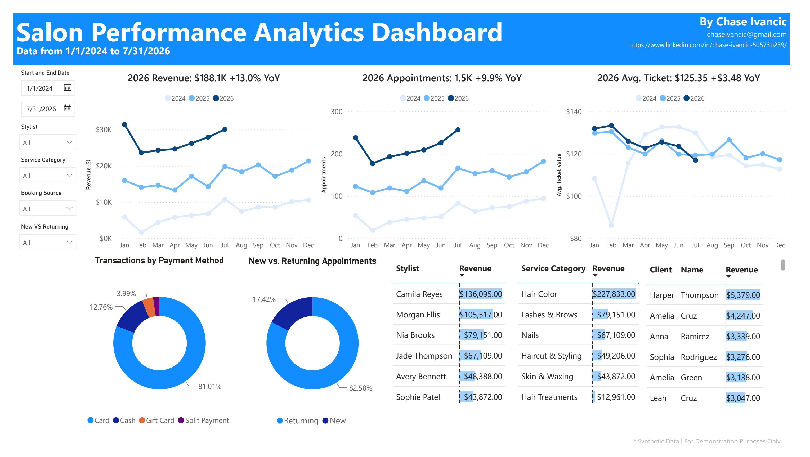
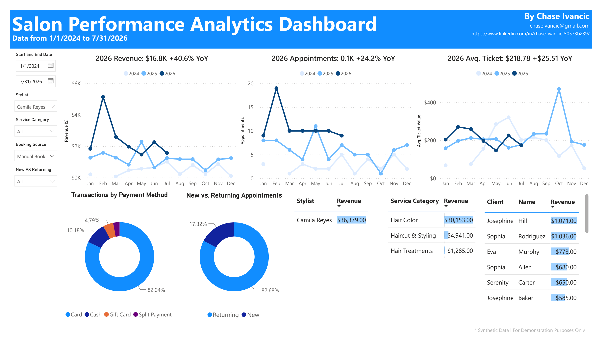

# Salon Analytics Dashboard
This interactive Power BI dashboard provides salon owners and managers with a centralized view of their business's financial and operational performance. By tracking key metrics such as total revenue, appointment volume, and average ticket value, users can monitor business growth, identify trends, and make informed decisions.

Interactive filters allow users to analyze performance by stylist, service category, client type, and date range, providing a more detailed understanding of the factors driving business performance.

The dashboard also highlights key business insights, including:
* Revenue and Appointment Trends: Compare monthly performance across multiple years to identify seasonal patterns and growth opportunities.
* Stylist Performance: Identify top revenue-generating stylists and evaluate their contributions to the business.
* Service Performance: Determine which services generate the most revenue and identify opportunities for optimization.
* Customer Behavior: Analyze new versus returning appointments and identify high-value clients.
* Payment Trends: Examine customer payment preferences and transaction distribution.

By combining financial, operational, and customer analytics, this dashboard helps salon owners identify opportunities to increase revenue, improve client retention, and optimize business operations.

## Dashboard Preview

  
<b>View Dashboard with Filters Applied</b>

   
  

## Technology & Skills
* Power BI: Interactive dashboard development, data visualization, slicers, and KPI reporting
* DAX: Custom measures, year-over-year comparisons, calculated columns, and dynamic KPI headlines
* Power Query: Data importing, transformation, and preparation
* Data Modeling: Relational table design, one-to-many relationships, and date dimension modeling
* SQL Server: Data querying, aggregation, joins, and business analysis

## Dataset Overview
This project uses a synthetically generated dataset designed to simulate salon business operations from 2024 through 2026. The dataset contains multiple related tables covering appointments, services, clients, transactions, and stylist performance
### Tables used in the Power BI Dashboard
The dashboard utilizes a subset of the available tables to calculate key performance indicators and support interactive filtering.
| Table | Description |
| --- | --- |
| Appointments | Contains appointments dates, client associations and appointment level information |
| Appointments_Services | Contains services performed during appointments and their actual prices. Used to calculate revenue |
| Transactions | Contains payment information, including payment methods and associated appointments |
| Clients | Contains customer information used for client level analysis |
| Calendar | Custom date dimension used for time based filtering and year-over-year comparisons |

## Business Questions & SQL Analysis
### 1. Which service categories are driving year-over-year revenue growth, and which are declining?
#### Business Objective

#### Technical Approach

#### SQL Concepts Demonstrated
CTEs:
#### Results

#### Business Insights
### 2. Are revenue increases being driven primarily by more appointments or by higher average ticket values?
#### Business Objective

#### Technical Approach

#### SQL Concepts Demonstrated

#### Results

#### Business Insights
### 3. Which clients are at the highest risk of not returning, based on their historical visit frequency?
#### Business Objective

#### Technical Approach

#### SQL Concepts Demonstrated

#### Results

#### Business Insights
### 4. Which stylists are improving their revenue performance the fastest over time?
#### Business Objective
Evaluate individual stylist revenue performance over time to identify growth trends and potential areas for improvement.
#### Technical Approach
Joined Appointments and Appointment_Services to calculate monthly revenue per stylist. Used CTEs and the LAG() window function to compare revenue against the previous recorded month and calculate month-over-month percentages.
#### SQL Concepts Demonstrated
* CTEs: Organized multi-step calculations.
* INNER JOIN: Combined appointment and service revenue data.
* SUM() & GROUP BY: Aggregated revenue by stylist and month.
* DATEADD() & DATEDIFF(): Grouped appointments into monthly periods.
* LAG() & PARTITION BY: Retrieved previous period revenue for each stylist
* NULLIF() & ROUND(): Handled division by zero and formatted growth percentages
#### Results
**SQL Code:** [View Full Query](./SQL/BusinessQuestion4.sql)

Generated monthly revenue totals, previous period revenue and MoM growth percentages for each stylist

* First 10 rows of the table

| Provider_ID | Revenue_Month           | Total_Revenue | Previous_Month_Revenue | MoM_Growth_Percent |
|-------------|-------------------------|---------------|------------------------|--------------------|
| PRV-001     | 2024-01-01 00:00:00.000 | 1248          | NULL                   | NULL               |
| PRV-001     | 2024-03-01 00:00:00.000 | 1775          | 1248                   | 42.23              |
| PRV-001     | 2024-04-01 00:00:00.000 | 2157          | 1775                   | 21.52              |
| PRV-001     | 2024-05-01 00:00:00.000 | 2144          | 2157                   | -0.6               |
| PRV-001     | 2024-06-01 00:00:00.000 | 2709          | 2144                   | 26.35              |
| PRV-001     | 2024-07-01 00:00:00.000 | 4118          | 2709                   | 52.01              |
| PRV-001     | 2024-08-01 00:00:00.000 | 1468          | 4118                   | -64.35             |
| PRV-001     | 2024-09-01 00:00:00.000 | 2922          | 1468                   | 99.05              |
| PRV-001     | 2024-10-01 00:00:00.000 | 1954          | 2922                   | -33.13             |

#### Business Insights
* Quickly identify stylists experiencing revenue growth or decline
* Detect seasonal trends
* Support revenue optimization and scheduling decisions
### 5. What appointment days and times experience the highest cancellation or no-show rates?
#### Business Objective

#### Technical Approach

#### SQL Concepts Demonstrated

#### Results

#### Business Insights
